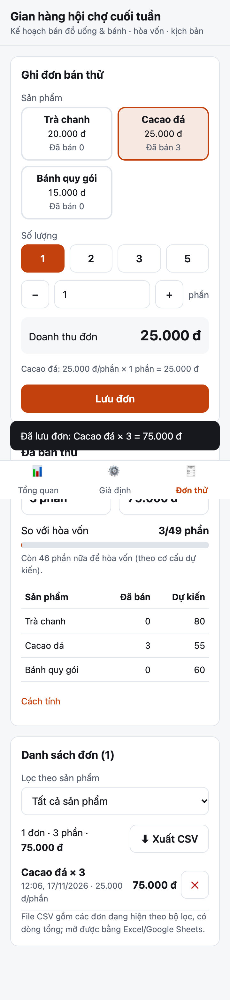
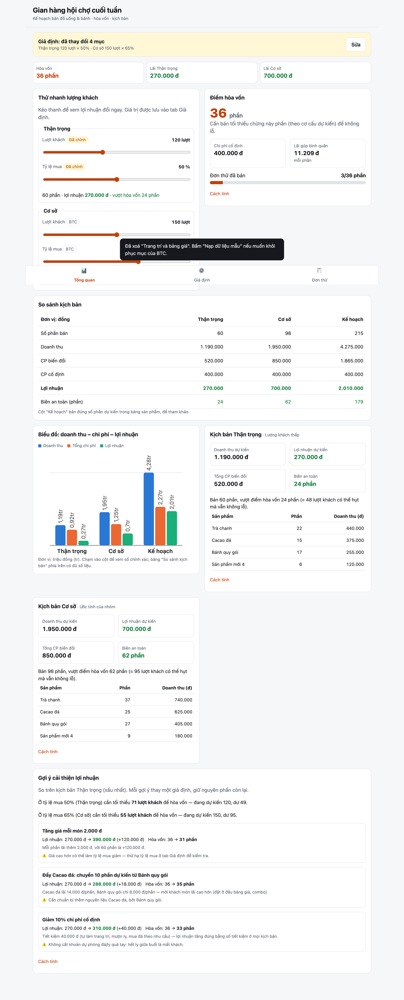

# Gian hàng hội chợ cuối tuần

Ứng dụng web tiếng Việt giúp nhóm sinh viên lập kế hoạch gian hàng đồ uống và bánh đóng gói: chỉnh giả định, ghi đơn bán thử, biết cần bán bao nhiêu phần để hòa vốn và so sánh kịch bản lượng khách.

## Link demo và cách mở
**https://minhquanvibecode.github.io/hoi-cho-gian-hang/**

Mở trên điện thoại hoặc máy tính là dùng được ngay: không cần đăng nhập, không cần cài đặt.

1. Mở link trên bằng Chrome hoặc Safari. Lưu ý: link phải có đuôi `/hoi-cho-gian-hang/`; trang gốc `minhquanvibecode.github.io` không có nội dung.
2. Tab **Giả định** → bấm **Nạp dữ liệu mẫu** → **Nạp dữ liệu mẫu** để có đúng dữ liệu BTC.
3. Tab **Tổng quan**: dải số Hòa vốn / Lãi Thận trọng / Lãi Cơ sở ở đầu trang; kéo thanh **Lượt khách**, **Tỷ lệ mua** để xem kết quả đổi theo.
4. Tab **Đơn thử**: chạm một món → chọn số lượng → **Lưu đơn**.
5. Quay lại **Tổng quan** để so sánh hai kịch bản (bảng, biểu đồ, thẻ từng kịch bản, khối "Cách tính").

Dữ liệu chỉ lưu trên trình duyệt đang dùng (localStorage). Trang được build và đăng lại tự động mỗi lần đẩy code lên nhánh `main`, sau khi toàn bộ test qua.

## Tính năng
### Theo yêu cầu đề
- [x] R1 Bảng sản phẩm: giá bán, chi phí biến đổi, số phần dự kiến; sửa được mọi giả định (sản phẩm, chi phí cố định, kịch bản).
- [x] R2 Ghi đơn bán thử: chọn sản phẩm + số lượng → doanh thu đơn hiện ngay, lưu đơn cộng vào "Đã bán".
- [x] R3 Doanh thu dự kiến, tổng chi phí biến đổi, chi phí cố định, lợi nhuận, số phần hòa vốn — có đơn vị và khối **Cách tính** (công thức → số thật → làm tròn).
- [x] R4 So sánh kịch bản Thận trọng và Cơ sở (thêm cột Kế hoạch để tham khảo); đổi lượt khách/tỷ lệ mua là cập nhật ngay.
- [x] R5 Thiết kế cho điện thoại 360px; toast khi lưu đơn/nạp mẫu/xoá đơn (có Hoàn tác); lỗi nhập hiện ngay dưới ô.
- [x] R6 Nút **Nạp dữ liệu mẫu** với hộp thoại xác nhận trong trang (tuỳ chọn xoá cả đơn thử).

### Phần nâng cao
- **Giả định có nguồn gốc**: mỗi ô có nhãn "BTC" hoặc "Đã chỉnh" (tô vàng, ghi giá trị BTC, nút ↺ trả về); banner ở Tổng quan báo đang chỉnh bao nhiêu ô.
- **Biên an toàn**: mỗi kịch bản vượt/thiếu bao nhiêu phần so với hòa vốn, quy ra số lượt khách có thể hụt mà vẫn không lỗ.
- **Kế hoạch so với thực tế**: thanh tiến độ đơn thử đã bán / số phần hòa vốn.
- **Dải số chính** ở đầu Tổng quan (Hòa vốn, Lãi Thận trọng, Lãi Cơ sở), thấy ngay ở màn hình đầu trên điện thoại.
- **Biểu đồ** cột so sánh doanh thu – tổng chi phí – lợi nhuận của Thận trọng, Cơ sở và Kế hoạch (khớp bảng so sánh); cột nào cũng có nhãn số, lợi nhuận âm thì cột đỏ dưới trục 0.
- **Báo lỗ rõ ràng**: khi lãi < 0, mọi nơi hiện "Lỗ X đ · thiếu N phần để hòa vốn" và dấu "−", không chỉ dựa vào màu đỏ.
- **Lọc đơn bán thử** theo sản phẩm, có tổng số đơn, số phần, doanh thu theo bộ lọc.
- **Ghi đơn nhanh tại quầy**: chạm ô sản phẩm (hiện giá và số đã bán) + nút số lượng nhanh 1/2/3/5 → 2–3 lần chạm là lưu xong một đơn.
- **Thanh trượt lượt khách và tỷ lệ mua** ngay trên Tổng quan: kéo là thấy số phần, lợi nhuận, biên an toàn đổi ngay; giá trị lưu chung với tab Giả định.
- **Thêm / xoá sản phẩm và khoản chi cố định** (có hộp thoại xác nhận; tối đa 8 sản phẩm, 10 khoản chi). Mục đội thêm có nhãn "Đội thêm"; "Nạp dữ liệu mẫu" trả về đúng danh mục BTC.
- **Xuất CSV** danh sách đơn bán thử theo bộ lọc (có dòng tổng, mở được bằng Excel/Google Sheets).
- **Bố cục 2 cột trên máy tính** (màn hình từ 900px), vẫn một cột trên điện thoại.
- **Gợi ý cải thiện** (tính bằng code, so trên kịch bản Thận trọng): tăng giá 2.000 đ, đẩy món lãi góp cao, giảm 10% chi phí cố định — kèm lợi nhuận và điểm hòa vốn trước/sau, cảnh báo đi kèm; số lượt khách tối thiểu để hòa vốn ở từng tỷ lệ mua.

## Công thức và cách làm tròn
| Chỉ số | Công thức | Đơn vị | Làm tròn |
|---|---|---|---|
| Lãi góp/phần | Giá bán − Chi phí biến đổi | đ/phần | không |
| Chi phí cố định | Tổng các khoản chi cố định | đ | không |
| Lãi góp bình quân | Σ(lãi góp × số phần dự kiến) ÷ Σ số phần dự kiến (cơ cấu 80:55:60) | đ/phần | giữ số lẻ khi tính |
| Số phần hòa vốn | Chi phí cố định ÷ Lãi góp bình quân | phần | **làm tròn lên** |
| Số khách mua | Lượt khách × Tỷ lệ mua | khách | gần nhất (0,5 lên) |
| Số phần từng món | Số khách mua × tỷ trọng số phần dự kiến | phần | phần nguyên, **phần dư lớn nhất** để tổng = số khách mua |
| Doanh thu | Σ(Giá bán × số phần) | đ | không |
| Tổng CP biến đổi | Σ(Chi phí biến đổi × số phần) | đ | không |
| Lợi nhuận | Doanh thu − CP biến đổi − CP cố định | đ | không |
| Biên an toàn | Số phần bán − Số phần hòa vốn | phần | — |
| Doanh thu đơn | Giá lúc ghi đơn × Số lượng | đ | không |

### Kết quả với dữ liệu BTC (khớp test `src/lib/calc/plan.test.ts`)
Lãi góp bình quân = 2.210.000 ÷ 195 = 11.333,33 đ/phần → hòa vốn 550.000 ÷ 11.333,33 = 48,53 → **49 phần**.

| | Thận trọng | Cơ sở |
|---|---|---|
| Số khách mua | 100 × 55% = 55 | 150 × 65% = 97,5 → 98 |
| Trà chanh / Cacao đá / Bánh quy | 23 / 15 / 17 | 40 / 28 / 30 |
| Doanh thu | 1.090.000 đ | 1.950.000 đ |
| CP biến đổi | 468.000 đ | 838.000 đ |
| CP cố định | 550.000 đ | 550.000 đ |
| Lợi nhuận | **72.000 đ** | **562.000 đ** |
| Biên an toàn | 6 phần | 49 phần |

## Dữ liệu mẫu và giả định
| Sản phẩm | Giá bán/phần (đ) | Chi phí biến đổi/phần (đ) | Số phần dự kiến |
|---|---|---|---|
| Trà chanh | 20.000 | 8.000 | 80 |
| Cacao đá | 25.000 | 11.000 | 55 |
| Bánh quy gói | 15.000 | 7.000 | 60 |

| Khoản chi cố định | Số tiền (đ) | Ghi chú |
|---|---|---|
| Phí thuê gian | 300.000 | Một ngày hội chợ |
| Trang trí và bảng giá | 150.000 | Chi một lần |
| Đá, ly và khăn giấy dự phòng | 100.000 | Ước tính cho ngày bán |

| Kịch bản | Lượt khách | Tỷ lệ mua | Ghi chú |
|---|---|---|---|
| Thận trọng | 100 | 55% | Lượng khách thấp |
| Cơ sở | 150 | 65% | Ước tính của nhóm |

Giả định của đội: mỗi khách mua 1 phần; mức thay đổi trong phần Gợi ý (+2.000 đ, chuyển 10 phần, −10% chi phí cố định) là ví dụ do đội chọn.

## Quyết định với điểm đề chưa rõ
| Đề chưa rõ | Cách xử lý |
|---|---|
| Mỗi khách mua mấy phần | 1 khách = 1 phần |
| 97,5 khách | Làm tròn gần nhất → 98 |
| Làm tròn từng món làm lệch tổng (23+16+17 = 56 ≠ 55) | Phần dư lớn nhất: tổng luôn bằng số khách mua |
| Hòa vốn 48,53 phần | Làm tròn lên 49 (bán 48 phần vẫn lỗ) |
| Cơ cấu tính lãi góp bình quân | Theo số phần dự kiến đang dùng (sửa số phần dự kiến → đổi theo) |
| Nạp mẫu có xoá đơn thử không | Mặc định giữ đơn; hộp thoại có ô "Xoá cả đơn bán thử" |
| Đổi giá sau khi đã ghi đơn | Đơn giữ giá lúc ghi |
| Xoá sản phẩm đã có đơn thử | Giữ đơn (doanh thu đơn không đổi); bộ lọc hiện "(đã xoá)" |
| Giá ≤ chi phí | Cảnh báo dưới ô; lãi góp bình quân ≤ 0 → "Không thể hòa vốn" |

## Công nghệ
| Phần | Công nghệ |
|---|---|
| Giao diện | React 19 + TypeScript 7, CSS thuần (thiết kế điện thoại 360px trước) |
| Build | Vite 8 (`base: './'`, chạy được ở mọi thư mục con) |
| Kiểm thử | Vitest 5 (23 test tính toán), Playwright (kiểm tra điện thoại, kịch bản demo) |
| Lưu dữ liệu | localStorage của trình duyệt, có phiên bản dữ liệu |
| Triển khai | GitHub Pages qua GitHub Actions (`.github/workflows/pages.yml`) |

Không có máy chủ, không đăng nhập, không khoá bí mật, không thu thập dữ liệu cá nhân.

## Cài đặt và chạy trên máy
Cần Node.js 20 trở lên (máy chủ build dùng Node 22) và git.

```bash
git clone https://github.com/minhquanvibecode/hoi-cho-gian-hang.git
cd hoi-cho-gian-hang
npm install
npm run dev        # mở http://localhost:5173
```

Các lệnh khác:

```bash
npm test           # chạy 23 test tính toán
npm run typecheck  # kiểm tra kiểu TypeScript
npm run build      # build ra thư mục dist/ (mở bằng bất kỳ máy chủ tĩnh nào)
npm run preview    # xem bản build tại http://localhost:4173
```

## Cấu trúc thư mục chính
| Đường dẫn | Nội dung |
|---|---|
| `src/config/seed.ts` | Dữ liệu mẫu BTC, chép nguyên văn từ đề |
| `src/lib/calc/` | Hàm tính hòa vốn, kịch bản, gợi ý + test |
| `src/components/` | Ba tab Tổng quan, Giả định, Đơn thử |
| `scripts/` | Kiểm tra điện thoại, kịch bản demo tự động, chụp minh chứng |
| `evidence/` | Ảnh và video minh chứng |
| `docs/` | Phân tích đề, nhật ký thời gian |

## Ảnh chụp (khổ 360px)
| Tổng quan | Giả định | Đơn thử |
|---|---|---|
|  |  |  |

## Bản nộp và minh chứng
Xem [NOP-BAI.md](NOP-BAI.md): link demo, source code, README và minh chứng tại thời điểm chốt (ảnh + video quay màn hình trong [evidence/nop-bai/](evidence/nop-bai/), tag `nop-bai` trên GitHub).

## Minh chứng quá trình
- Lịch sử commit: https://github.com/minhquanvibecode/hoi-cho-gian-hang/commits/main
- Nhật ký thời gian: [docs/TIMELINE.md](docs/TIMELINE.md)
- Phân tích đề: [docs/PHAN-TICH-DE.md](docs/PHAN-TICH-DE.md)
- Kiểm tra điện thoại: `scripts/check-mobile.mjs`; chạy kịch bản demo tự động (15 bước, gồm cả khổ máy tính 1280px): `scripts/demo-flow.mjs` (ảnh trong `evidence/`)


